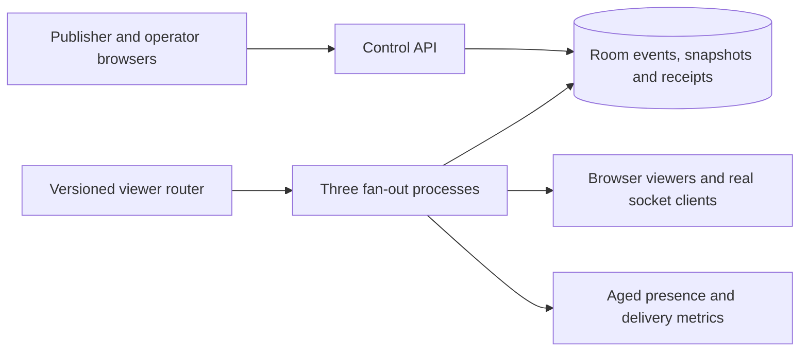

# CrowdLattice

Let viewers follow a live score and announcements, reconnect without losing their place, and recover from a failed fan-out worker. Operators see real sockets, capacity grants and aged presence as separate facts.

**Stage:** requirements and design baseline, 23 November 2026. Runtime implementation has not started. Acceptance, load and recovery results are NOT RUN.

A successful publish commits one ordered room event and matching snapshot. Delivery may repeat; viewers deduplicate by room generation and sequence. This product distributes application updates, not video or audio.

Start with the [documentation guide](docs/README.md), [product scope](docs/requirements/product.md), [high-level architecture](docs/architecture/high-level-design.md) and [component designs](docs/design/README.md).

[Worked examples](examples/README.md), [JSON Schemas](schemas/README.md) and [reference SQL](schemas/reference-schema.sql) accompany the design. They specify contracts; they do not constitute an engine implementation.

The reference design uses Python services, SQLite coordination on local disk, and basic locally served HTML/CSS/JavaScript. Exact dependencies remain subject to permitted-environment verification. [Capacity analysis](docs/testing/performance-and-capacity.md) separates real local evidence from unverified deployment arithmetic.

Public repository, [MIT license](LICENSE). The [original requirements](docs/source/Mass_Audience_Live_Event_Platform_Requirements.md) remain archived. Documentation is AI-assisted; programme decisions and participant-authored answers remain separate.
