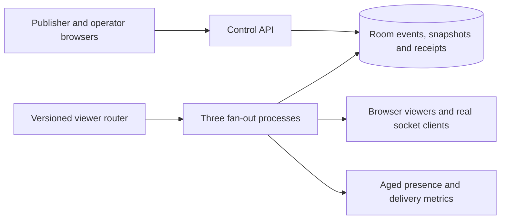
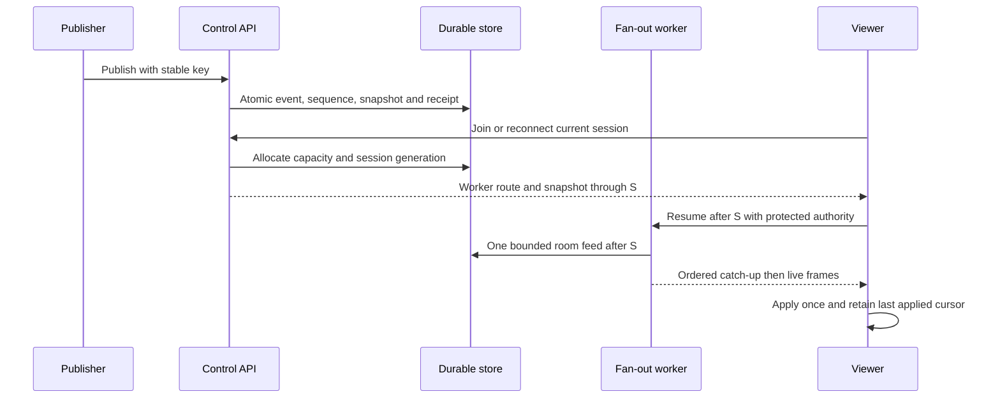

# High-level design

Let viewers follow a live score and announcements, reconnect without losing their place, and recover from a failed fan-out worker. Operators see real sockets, capacity grants and aged presence as separate facts.

## Deployment boundary

A successful publish commits one ordered room event and matching snapshot. Delivery may repeat; viewers deduplicate by room generation and sequence. This product distributes application updates, not video or audio.

All runtime services are ordinary local processes. Assets stay local, HTTP targets stay on loopback, and the canonical store lives outside synchronized/network folders. Supporting multiple application processes demonstrates shared-state races; it does not establish cross-machine fault tolerance.

## Main journey

## Logical components

| Component | Responsibility |
| --- | --- |
| [Room lifecycle ordered publish and snapshots](../design/publication.md) | Validate LIVE room and registered score-set/status-set/announcement payload <=8 KiB. |
| [Snapshot to stream handoff replay and reset](../design/replay.md) | Read snapshot and sequence S from one committed view. |
| [Hot-room placement and shared upstream feeds](../design/fanout.md) | Map room/session identity into 256 stable virtual buckets using declared hash version. |
| [Capacity grants and connection generations](../design/sessions.md) | Atomically reserve finite worker grant capacity against the global configured cap. |
| [Slow viewers bounded buffers and reconnect control](../design/backpressure.md) | Bound per-client reliable outbound storage by both 64 KiB and 256 frames. |
| [Worker drain loss and safe reconnection](../design/recovery.md) | Mark DRAINING and reject new placement under a new routing-map revision. |
| [Presence and actual connection accounting](../design/presence.md) | Report per-worker sockets and currently owned session estimates every five seconds. |

Control API, browser, storage, observability and test harness have separate designs. The [transaction protocol](../design/transactions.md) governs every durable mutation.

## Capacity boundary

Local qualification: Three fan-out workers; staged 100, 250 and 500 real protocol connections, one hot room at ten 256-byte events/s and a second independent room. Basic browser tests use a few real tabs.

Analytical study: Five million viewers receiving 256 bytes once/s require 1.28 GB/s or 10.24 Gbit/s application egress before overhead; ten updates/s requires ten times that. At 16 KiB state/viewer, state alone is 81.92 GB decimal. Reconnecting 20% over 30 seconds is 33,333.33 joins/s.

The canonical shared writer and hot-key state remain known serialization points. Production partitioning/edge deployments are analysis only until implemented and failure-tested.
