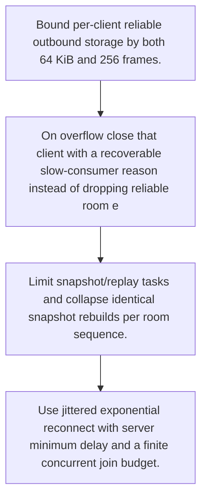

# Slow viewers bounded buffers and reconnect control

Heartbeats have no application sequence. Presence summaries may coalesce because they are observations. Room switching closes the old stream and timers. A stalled viewer cannot monopolize feed processing or operator health capacity.

## Algorithm

1. Bound per-client reliable outbound storage by both 64 KiB and 256 frames.
2. On overflow close that client with a recoverable slow-consumer reason instead of dropping reliable room events.
3. Limit snapshot/replay tasks and collapse identical snapshot rebuilds per room sequence.
4. Use jittered exponential reconnect with server minimum delay and a finite concurrent join budget.

## Interfaces and storage boundary

Inputs include the target identity, caller/process identity, expected version/generation when applicable and operation key. The service returns a bounded committed result or stable error. [API fields](../contracts/api.md) and [data entities](../contracts/data-model.md) define the interface. No network send or computation waits inside the database writer.

The [transaction protocol](transactions.md) handles repeated receipts, contention, uncertain COMMIT and current-authority checks. New work rechecks mutable state after acquiring the writer. A stale client is not silently upgraded to a newer revision.

## Required behavior

## Backpressure and reconnection control

Per-client buffered outbound data is bounded, proposed 64 KiB and/or 256 frames. When a reliable event would overflow the limit, close that client's stream with a recoverable slow-consumer reason and retain its last known cursor semantics. Do not silently drop scoreboard events. Presence summaries may be coalesced because they are explicitly nonauthoritative observations.

Bound replay work, concurrent snapshot generation and joins per worker. Cache/share identical snapshots by room generation/sequence; collapse concurrent snapshot rebuilds. Reconnect uses bounded exponential backoff and jitter. A server-provided delay is a minimum, not a synchronized wake-up instruction for all clients.

Heartbeats distinguish a healthy idle room from a broken transport; they do not advance the application sequence. Disconnecting a viewer frees local resources once and updates observed counts. Work that belongs to a stalled client cannot delay unrelated clients or the operator health endpoint.

## Recovery and evidence

A failure before commit exposes no accepted transition; a lost response after commit is resolved with the same key. A second reconciler reloads current state and cannot duplicate a terminal transition. Test both serialization orders at the relevant race, using the [harness](../testing/harness-and-fixtures.md) and [source acceptance cases](../testing/acceptance-plan.md). These are planned tests, not observed results.
