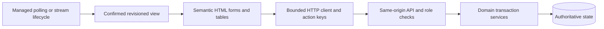

# Browser and API module design

The planned frontend is index.html, styles.css and JavaScript modules for API calls, state, forms and the project transport. The backend serves every asset locally. A framework is unnecessary. TypeScript, if selected later, compiles offline into the served JavaScript.

Client mutation state is idle, pending, accepted, conflicted or failed. Generate a key before sending and reuse it across double-click/uncertain response/reload for the same intent. Do not store protected authority in URLs or log it. Cookies or protected headers carry disposable identity. Escape all text; never render arbitrary payload HTML.

Each screen handles loading, empty, stale, disconnected and permission errors. Keyboard focus/order, text status and table alternatives cover every action. The browser cannot grant stock, quota or capacity by changing local state.

## Browser experience

Viewer screens show event selection, snapshot loading, connected/reconnecting/reset states, current score/status, ordered announcements and last update age. Operator screens show room lifecycle, publish form, real connections per worker, allocation versus presence, slow clients, replay lag and drain controls.

Two tabs exercise independent sessions unless explicitly sharing a synthetic session ID for ownership tests. Refresh resumes from the documented cursor or fetches a consistent reset. Provide keyboard access, text states, accessible tables for charts and no success notification before durable publish acceptance. No screen may display a modeled 5-million population as actual connected viewers.

### Basic HTML and JavaScript or TypeScript UI

A basic working UI is a mandatory release deliverable. Use semantic HTML, ordinary CSS and plain JavaScript, or TypeScript compiled to browser JavaScript. The backend implementation language remains open. Use native browser APIs for HTTP requests and the selected streaming protocol. Tables, forms, status labels and optional small SVG charts are sufficient.

| Minimum view | Visible information and working controls |
| --- | --- |
| Viewer page | Room selector, join/reconnect control, current score/status, announcements, connection state, last sequence and update age. |
| Operator page | Room creation/start/end, validated event publish form, worker table, active sockets, allocated capacity and drain action. |
| Diagnostics panel | Readiness, reconnect/reset counts, slow-client count and bounded recent events/errors. |

| ID | Basic UI requirement |
| --- | --- |
| LA-UI-01 | Serve HTML, CSS, scripts and optional assets from the local application origin; all required flows work without external connectivity. |
| LA-UI-02 | JavaScript is the dependency-minimal path. If TypeScript is selected, use a compiler available through the permitted mirror, document the local compile command and serve the generated JavaScript. Browsers must not require a TypeScript compiler or internet downloads at runtime. |
| LA-UI-03 | Keep the frontend small: an HTML entry page, CSS file and JavaScript modules, with corresponding TypeScript source only if chosen. Any selected library must be bundled locally and pass the dependency gate; no framework is required. |
| LA-UI-04 | Wire controls to real local APIs and the real streaming connection. Show loading, accepted, reconnecting, stale, empty and error states from actual server outcomes. |
| LA-UI-05 | Bound the rendered event list, reuse the active stream and release browser resources when switching rooms. A UI refresh must not create uncontrolled duplicate connections. |
| LA-UI-06 | Labels, keyboard operation, text status and inline validation cover every action. Operator actions remain authorized and validated by the backend. |

Frontend acceptance is functional: a reviewer can join a room, publish an update, see it arrive, interrupt a worker, observe recovery and inspect the resulting state using the basic pages. Bulk load remains the separate protocol-client harness; the UI does not create millions of DOM elements or claim that a displayed population is measured live traffic.

Frontend acceptance uses the real APIs/transport. These are designs for the future runtime UI; this documentation baseline contains no fake working dashboard.
