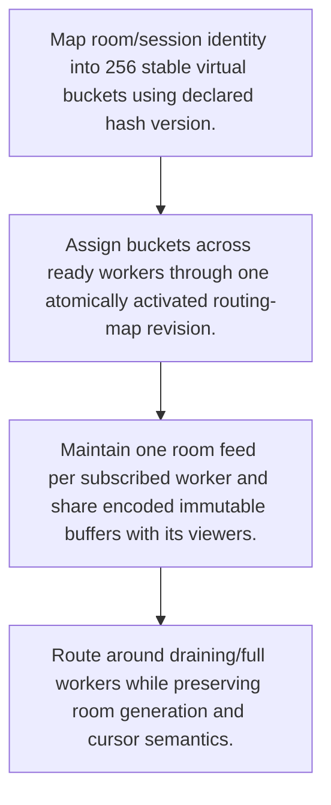

# Hot-room placement and shared upstream feeds

Proposed placement uses SHA-256(roomId + separator + sessionId) modulo 256 and a complete bucket-to-worker map. The separator/encoding is fixed in the routing contract. One hot room can span all workers; room-only hashing would fail this requirement.

## Algorithm

1. Map room/session identity into 256 stable virtual buckets using declared hash version.
2. Assign buckets across ready workers through one atomically activated routing-map revision.
3. Maintain one room feed per subscribed worker and share encoded immutable buffers with its viewers.
4. Route around draining/full workers while preserving room generation and cursor semantics.

## Interfaces and storage boundary

Inputs include the target identity, caller/process identity, expected version/generation when applicable and operation key. The service returns a bounded committed result or stable error. [API fields](../contracts/api.md) and [data entities](../contracts/data-model.md) define the interface. No network send or computation waits inside the database writer.

The [transaction protocol](transactions.md) handles repeated receipts, contention, uncertain COMMIT and current-authority checks. New work rechecks mutable state after acquiring the writer. A stale client is not silently upgraded to a newer revision.

## Required behavior

## Fan-out and hot-room design

Each worker maintains at most one upstream room feed for its subscribed viewers, sharing immutable encoded event buffers where practical. It must not fetch or deserialize the same room event independently for every viewer. The number of authoritative room-feed reads scales primarily with subscribed workers/rooms, not viewer count.

The same hot room must be distributable across all 3 local workers. Placement by room alone cannot assign a 5-million-viewer room to one process. Use stable virtual buckets based on room/session IDs plus a versioned worker map; the exact routing algorithm is an implementation decision with tests.

Worker capacity, outbound bytes and per-room subscriptions are observable. Routing should avoid full workers and retain bounded spare capacity. Worker changes must preserve event identity and cursors. No worker-local memory is the sole durable publication history.

## Recovery and evidence

A failure before commit exposes no accepted transition; a lost response after commit is resolved with the same key. A second reconciler reloads current state and cannot duplicate a terminal transition. Test both serialization orders at the relevant race, using the [harness](../testing/harness-and-fixtures.md) and [source acceptance cases](../testing/acceptance-plan.md). These are planned tests, not observed results.
