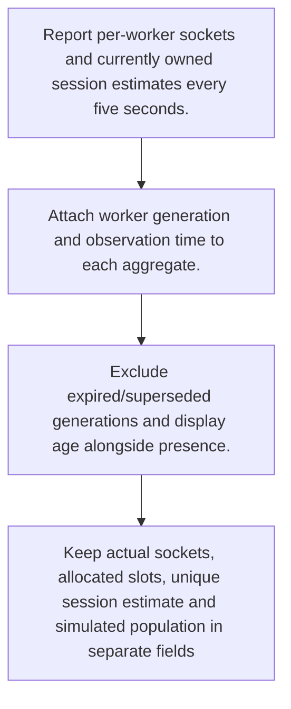

# Presence and actual connection accounting

Presence is best effort and cannot debit/grant admission. Record end-to-end per-client sequence/lag observations; histograms include disconnects and generator failures, not only healthy viewers. Avoid a durable write for every viewer on every frame.

## Algorithm

1. Report per-worker sockets and currently owned session estimates every five seconds.
2. Attach worker generation and observation time to each aggregate.
3. Exclude expired/superseded generations and display age alongside presence.
4. Keep actual sockets, allocated slots, unique session estimate and simulated population in separate fields.

## Interfaces and storage boundary

Inputs include the target identity, caller/process identity, expected version/generation when applicable and operation key. The service returns a bounded committed result or stable error. [API fields](../contracts/api.md) and [data entities](../contracts/data-model.md) define the interface. No network send or computation waits inside the database writer.

The [transaction protocol](transactions.md) handles repeated receipts, contention, uncertain COMMIT and current-authority checks. New work rechecks mutable state after acquiring the writer. A stale client is not silently upgraded to a newer revision.

## Required behavior

## Presence and observability semantics

Workers report aggregated active-socket and current-session estimates periodically, initially every 5 seconds. Presence is best effort with an age indicator, not a database write for every viewer on every event. Exclude expired worker generations from the estimate. Do not use approximate presence to decide strict admission caps.

Metrics include active connections, allocated capacity, admission rejects, events published/delivered, per-room fan-out factor, egress bytes, send lag, slow consumers, replay/reset counts, reconnect arrival rate and worker health. Label actual socket counts separately from simulated logical population. Histograms include disconnects/timeouts and generator failures, not just fast successful viewers.

## Recovery and evidence

A failure before commit exposes no accepted transition; a lost response after commit is resolved with the same key. A second reconciler reloads current state and cannot duplicate a terminal transition. Test both serialization orders at the relevant race, using the [harness](../testing/harness-and-fixtures.md) and [source acceptance cases](../testing/acceptance-plan.md). These are planned tests, not observed results.
