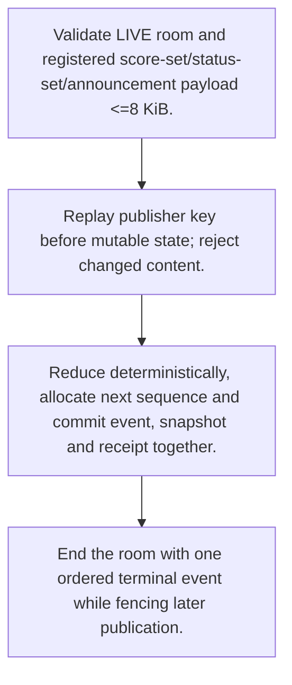

# Room lifecycle ordered publish and snapshots

Room generation is immutable, sequence begins at one, and rollback exposes no gap. End is an internal typed terminal event distinct from allowed publisher event types. Cache snapshots are disposable; committed sequence/state is authoritative.

## Algorithm

1. Validate LIVE room and registered score-set/status-set/announcement payload <=8 KiB.
2. Replay publisher key before mutable state; reject changed content.
3. Reduce deterministically, allocate next sequence and commit event, snapshot and receipt together.
4. End the room with one ordered terminal event while fencing later publication.

## Interfaces and storage boundary

Inputs include the target identity, caller/process identity, expected version/generation when applicable and operation key. The service returns a bounded committed result or stable error. [API fields](../contracts/api.md) and [data entities](../contracts/data-model.md) define the interface. No network send or computation waits inside the database writer.

The [transaction protocol](transactions.md) handles repeated receipts, contention, uncertain COMMIT and current-authority checks. New work rechecks mutable state after acquiring the writer. A stale client is not silently upgraded to a newer revision.

## Required behavior

## Room and publication requirements

| ID | Requirement |
| --- | --- |
| ROOM-01 | Create a room with immutable ID/generation, bounded event schema and versioned configuration. |
| ROOM-02 | Room states are DRAFT, LIVE and ENDED. Start/end use expected revision and operation key; ENDED does not reopen. |
| ROOM-03 | Publishing accepts only registered event types: score-set, status-set and announcement. Payloads are plain validated data. |
| ROOM-04 | Canonical event, next sequence, room snapshot/reducer state and publisher receipt commit atomically. Rollback exposes no sequence gap. |
| ROOM-05 | Same publisher key and request returns the original event; changed content with that key conflicts. |
| ROOM-06 | Publication is bounded to 8 KiB/event, with a 256-byte synthetic payload profile for capacity analysis. |
| ROOM-07 | Ending a room rejects new events and emits an ordered terminal event. Retained reads and snapshot inspection remain possible. |

Use a documented canonical serialization and content digest; reject duplicate JSON keys, invalid numbers, unknown fields and unsupported versions. Snapshot reduction must be deterministic and validated against an independent reference reducer. Browser labels and announcements are escaped text, never arbitrary HTML.

## Recovery and evidence

A failure before commit exposes no accepted transition; a lost response after commit is resolved with the same key. A second reconciler reloads current state and cannot duplicate a terminal transition. Test both serialization orders at the relevant race, using the [harness](../testing/harness-and-fixtures.md) and [source acceptance cases](../testing/acceptance-plan.md). These are planned tests, not observed results.
