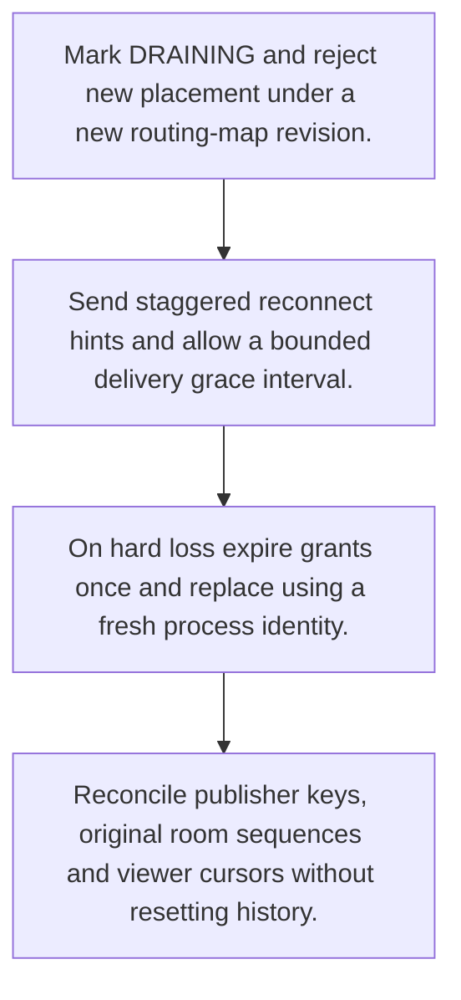

# Worker drain loss and safe reconnection

A failed grant is not reassigned while still spendable by its old generation. On control-store outage existing streams continue only until their conservative valid authority expires; publishing and new joins fail clearly. Replacement workers catch up from durable history.

## Algorithm

1. Mark DRAINING and reject new placement under a new routing-map revision.
2. Send staggered reconnect hints and allow a bounded delivery grace interval.
3. On hard loss expire grants once and replace using a fresh process identity.
4. Reconcile publisher keys, original room sequences and viewer cursors without resetting history.

## Interfaces and storage boundary

Inputs include the target identity, caller/process identity, expected version/generation when applicable and operation key. The service returns a bounded committed result or stable error. [API fields](../contracts/api.md) and [data entities](../contracts/data-model.md) define the interface. No network send or computation waits inside the database writer.

The [transaction protocol](transactions.md) handles repeated receipts, contention, uncertain COMMIT and current-authority checks. New work rechecks mutable state after acquiring the writer. A stale client is not silently upgraded to a newer revision.

## Required behavior

## Worker drain failure and recovery

Worker lifecycle: STARTING, READY, DRAINING, UNAVAILABLE, STOPPED. Draining stops new joins, signals reconnect hints with staggered delays and allows bounded active delivery before shutdown. Failed-worker grants expire; replacement workers use new process identities and subscription positions.

Routing-map revisions and worker generations are checked on join and migration. A stale worker cannot reclaim ownership by advertising its old ID. Several local reconcilers may observe the same expiry; conditional transitions and unique grants prevent double reassignment.

Publisher restart reuses durable keys or creates explicit new events; it must not repeat the same fixture sequence as new content accidentally. Store outage stops publishing and new admission, preserves current cursors, and returns clear readiness failure. Restart must not erase event history, reset room generation or fabricate live audience counts.

## Recovery and evidence

A failure before commit exposes no accepted transition; a lost response after commit is resolved with the same key. A second reconciler reloads current state and cannot duplicate a terminal transition. Test both serialization orders at the relevant race, using the [harness](../testing/harness-and-fixtures.md) and [source acceptance cases](../testing/acceptance-plan.md). These are planned tests, not observed results.
