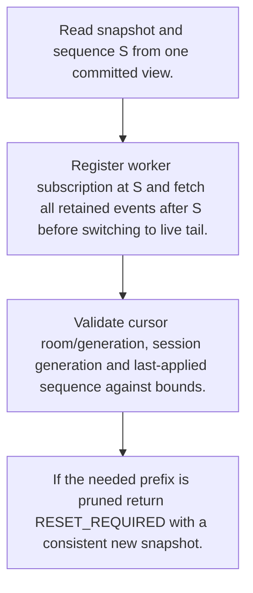

# Snapshot to stream handoff replay and reset

A cursor means last applied, not last sent. At retained low sequence L, cursor L-1 is valid because replay begins at L; older cursors require reset. Catch-up/live handoff deduplicates overlapping sequences and never silently skips a gap.

## Algorithm

1. Read snapshot and sequence S from one committed view.
2. Register worker subscription at S and fetch all retained events after S before switching to live tail.
3. Validate cursor room/generation, session generation and last-applied sequence against bounds.
4. If the needed prefix is pruned return RESET_REQUIRED with a consistent new snapshot.

## Interfaces and storage boundary

Inputs include the target identity, caller/process identity, expected version/generation when applicable and operation key. The service returns a bounded committed result or stable error. [API fields](../contracts/api.md) and [data entities](../contracts/data-model.md) define the interface. No network send or computation waits inside the database writer.

The [transaction protocol](transactions.md) handles repeated receipts, contention, uncertain COMMIT and current-authority checks. New work rechecks mutable state after acquiring the writer. A stale client is not silently upgraded to a newer revision.

## Required behavior

## Snapshot and replay protocol

A new viewer receives a snapshot through sequence S and then events after S. Snapshot state and S come from one consistent durable view. The subsequent subscription must catch up from S before following live updates so an event between snapshot read and connection establishment is not lost.

Reconnect supplies room generation, session identity/generation and last applied sequence. Within the replay window, return events in order before live tailing. A cursor from another room/generation, a cursor beyond high-water, or malformed cursor is rejected.

Keep a bounded replay window, initially 10,000 events or 10 minutes, with an explicit low-water. If history is no longer retained, send RESET_REQUIRED and a new snapshot; never silently skip to the newest event. Snapshots and retained events must overlap consistently at the retention boundary. A reset is visible in the viewer UI and metrics.

## Recovery and evidence

A failure before commit exposes no accepted transition; a lost response after commit is resolved with the same key. A second reconciler reloads current state and cannot duplicate a terminal transition. Test both serialization orders at the relevant race, using the [harness](../testing/harness-and-fixtures.md) and [source acceptance cases](../testing/acceptance-plan.md). These are planned tests, not observed results.
