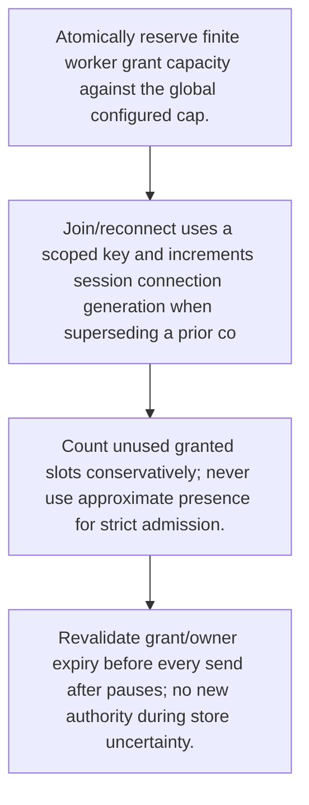

# Capacity grants and connection generations

Grant TTL is 15 seconds, renewal every five. The worker derives a conservative monotonic send deadline from database remaining TTL minus measured request time and a proposed 500 ms safety margin. Long process suspension triggers a fresh check before streaming resumes.

## Algorithm

1. Atomically reserve finite worker grant capacity against the global configured cap.
2. Join/reconnect uses a scoped key and increments session connection generation when superseding a prior connection.
3. Count unused granted slots conservatively; never use approximate presence for strict admission.
4. Revalidate grant/owner expiry before every send after pauses; no new authority during store uncertainty.

## Interfaces and storage boundary

Inputs include the target identity, caller/process identity, expected version/generation when applicable and operation key. The service returns a bounded committed result or stable error. [API fields](../contracts/api.md) and [data entities](../contracts/data-model.md) define the interface. No network send or computation waits inside the database writer.

The [transaction protocol](transactions.md) handles repeated receipts, contention, uncertain COMMIT and current-authority checks. New work rechecks mutable state after acquiring the writer. A stale client is not silently upgraded to a newer revision.

## Required behavior

## Session ownership and admission

| ID | Requirement |
| --- | --- |
| SES-01 | Synthetic viewer sessions have opaque IDs and replaceable connection generations. A new connection generation supersedes the prior one. |
| SES-02 | Join/reconnect is idempotent by scoped request key and cannot create unbounded duplicate session records. |
| SES-03 | Allocate finite worker capacity grants atomically; total active grants never exceed the configured local global cap. |
| SES-04 | Unused granted capacity remains reserved until release/expiry, preventing over-admission through optimistic counters. |
| SES-05 | A worker losing its capacity/ownership lease stops admission and streaming before using expired authority. |
| SES-06 | Control-store uncertainty produces bounded degraded behaviour: existing streams run only under still-valid grants; no new grants are invented. |
| SES-07 | Session transport values are disposable local demo credentials, never real account tokens. |

Proposed worker-grant TTL is 15 seconds, renewal every 5 seconds. Document durable-time versus process-monotonic-clock conversion and a conservative expiry margin. A process resumed after a long scheduling pause checks expiry before sending again. Session migration excludes old generations from unique presence, although duplicate event delivery during reconnection remains possible and harmless after cursor deduplication.

Admission over the configured cap returns a retryable overload response with jitter guidance. It does not accept a socket and wait indefinitely in an unbounded queue. No production bot resistance or proof that one synthetic ID equals one real human is claimed.

## Recovery and evidence

A failure before commit exposes no accepted transition; a lost response after commit is resolved with the same key. A second reconciler reloads current state and cannot duplicate a terminal transition. Test both serialization orders at the relevant race, using the [harness](../testing/harness-and-fixtures.md) and [source acceptance cases](../testing/acceptance-plan.md). These are planned tests, not observed results.
