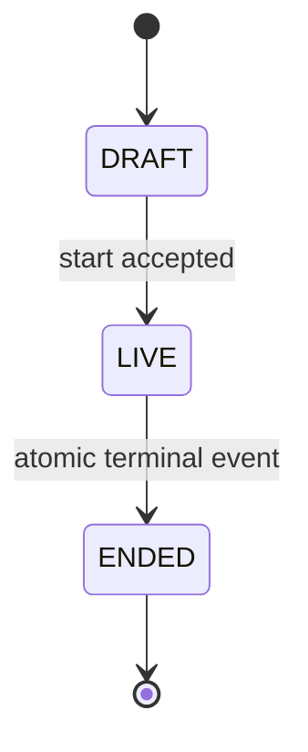
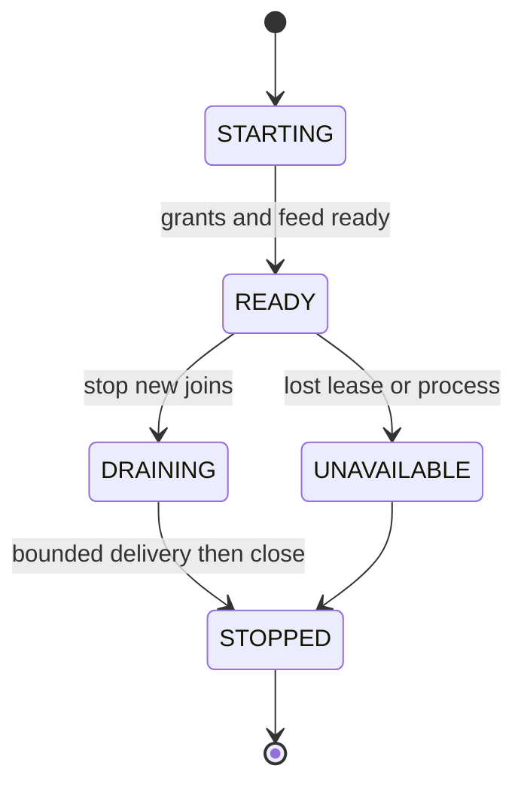

# State machines and race outcomes

Additional states and transition guards are in the [software requirements](../requirements/software.md). Terminal records do not reopen; receipt replay proves a former commit without making a new transition.

| Race | Outcome |
| --- | --- |
| Completion versus deadline | Only a serialized transition with valid current authority can newly commit. |
| New control versus new work | The first valid committed transition determines admission under the pinned/current-state rules. |
| Two workers settle one due record | One conditional transition wins; the other records no duplicate terminal event. |
| Commit versus lost response | Replay original identity/key; transport timeout does not imply rollback. |
| Lowered limits versus occupancy | Existing valid occupancy drains; no new grant exceeds the effective admission rule. |
