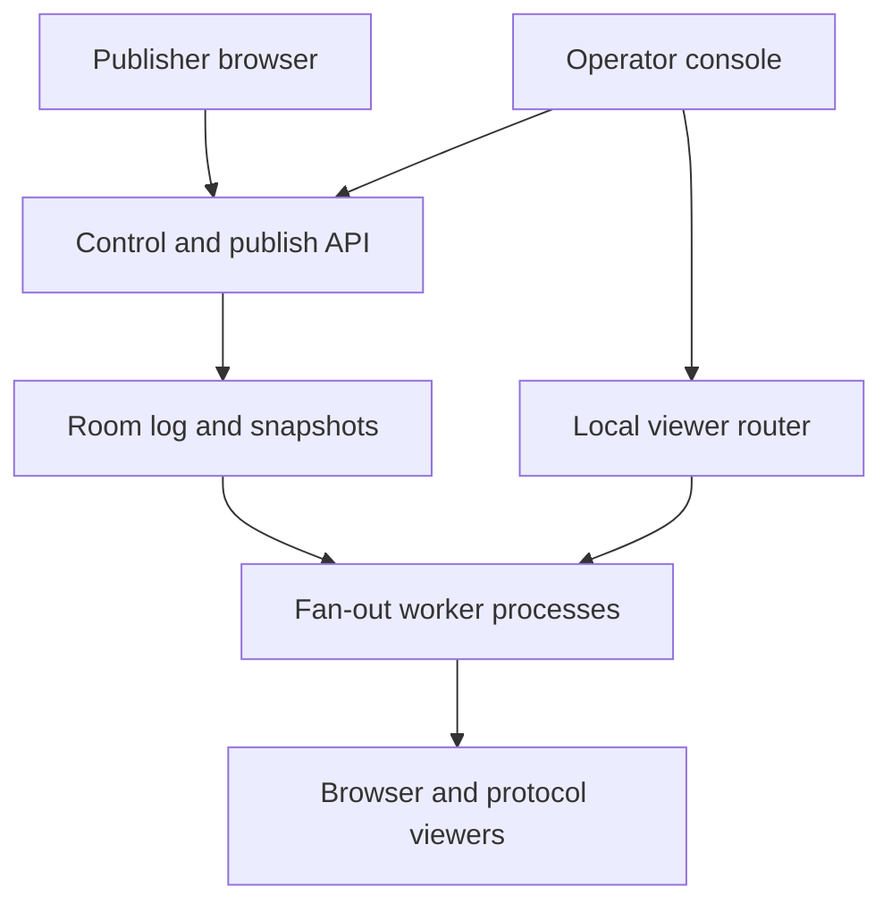

# Product requirements and scope

Let viewers follow a live score and announcements, reconnect without losing their place, and recover from a failed fan-out worker. Operators see real sockets, capacity grants and aged presence as separate facts.

## Purpose and product

Build CrowdLattice, a browser application for a large live event: viewers join a room, receive ordered scoreboard/status updates and announcements, reconnect after interruption, and see explicit recovery or overload states. Operators publish updates, inspect audience distribution, drain a fan-out worker and investigate delivery lag.

The architecture explores a target of 5 million concurrent viewers. The required implementation is an actual local application with separate fan-out processes, real streaming connections, durable room history and controlled load tests. Five million concurrent viewers is an unvalidated deployment hypothesis, not a desktop acceptance claim.

This product distributes live application updates, not video or audio. Video capture, encoding, playback quality, adaptive bitrate delivery and CDN operation are outside the submitted goal. No claim that this project can stream video to 5 million people may be made from its results.

## Why the project is substantial

The difficult work is one hot room being consumed by many sessions without a database query per viewer per event, preserving event order through reconnects, bounding slow-client memory, and recovering a failed fan-out worker without a reconnect storm. The product needs coordinated state, browser behaviour, streaming I/O, recovery and credible measurement together.

Users are fictional event viewers, event publishers, operators and developers investigating capacity. The demonstration uses generated teams/devices, scores, announcements and viewer identities. It uses no employer infrastructure, real viewers, personal data, customer accounts or commercial video assets.

## Scale and evidence contract

| Level | Requirement and permitted claim |
| --- | --- |
| Product core | Local room creation, publication, real browser delivery, replay, reconnect and worker recovery must run end to end. |
| Local qualification | Begin with 100 real streaming client connections; provisional target is 500 across 3 fan-out processes on the supplied machine. |
| Larger local experiments | Increase real clients only within measured CPU, memory, socket and load-generator limits. Preserve failed runs. |
| Capacity analysis | Model 5 million concurrent sessions using recorded assumptions and measurements, with uncertainty and headroom. |
| Logical simulation | Optional millions-of-session placement calculations use simulated records; they are never counted as live sockets. |
| Production proof | Requires separate authorized infrastructure and tests; not part of this restricted-desktop project or its success bar. |

Do not substitute 5 million page views, stored rows, sequential requests or simulated clients for simultaneous real connections. The local success criteria stand independently even if the large-scale hypothesis is not yet achievable.

## Fit with the restricted desktop

Run an API/control process, a durable local store and at least 3 fan-out worker processes over loopback. Serve the browser UI and all assets locally. The load generator uses actual local network sockets and generated data. No internet, Docker, GPU, sound, native desktop toolkit, cloud account or Windows component is needed.

## Release scope and exclusions

Required: versioned event rooms; immutable ordered publications; idempotent publisher requests; materialized room snapshots; bounded replay; fan-out sharding; session ownership generations; reconnect tokens; per-client backpressure; worker drain/recovery; approximate presence; admission capacity; operator and viewer UIs; local load/fault harness; measurements and capacity workbook.

Deferred: video/audio, free-form public chat, actual millions of connections, multi-region consensus, global identity, billing, public deployment, cross-machine failover, mobile apps, AI functionality, untrusted user code and production moderation. Core correctness uses one authoritative local durable store; a shared store outage is not masked as a production-available cluster.

## Reference scenario

Create a fictional championship room and a second independent room. A publisher emits deterministic score/status events at 10 events/second for the local fan-out exercise. Open viewer browsers and 500 headless protocol clients distributed across 3 workers. Pause one client, kill one worker, restart the publisher and force selected clients to reconnect with earlier cursors.

Every client records room generation, last applied sequence, detected duplicates/gaps and delivery lag. After recovery, healthy clients must reach the same snapshot digest through a shared final sequence. Slow clients must receive an explicit reset/disconnect rather than make memory grow indefinitely.

## Definitions and guarantees

Room ID and generation identify one event history. Sequence starts at 1, increases on committed publications and never resets within a generation. A snapshot is room state through a specific sequence S. A viewer cursor is the last sequence applied, not merely sent over a socket.

The service guarantees committed publication durability under its store settings, per-room ordered data and explicit recovery from detectable gaps. Streaming delivery may repeat around reconnect; clients discard already applied sequences. There is no universal exactly-once network delivery guarantee.

A successful publish proves durable acceptance, not that all connected browsers received it. Operator presence is a timestamped estimate; allocated capacity, active sockets and unique currently owned viewer sessions are different metrics and must not be conflated.
