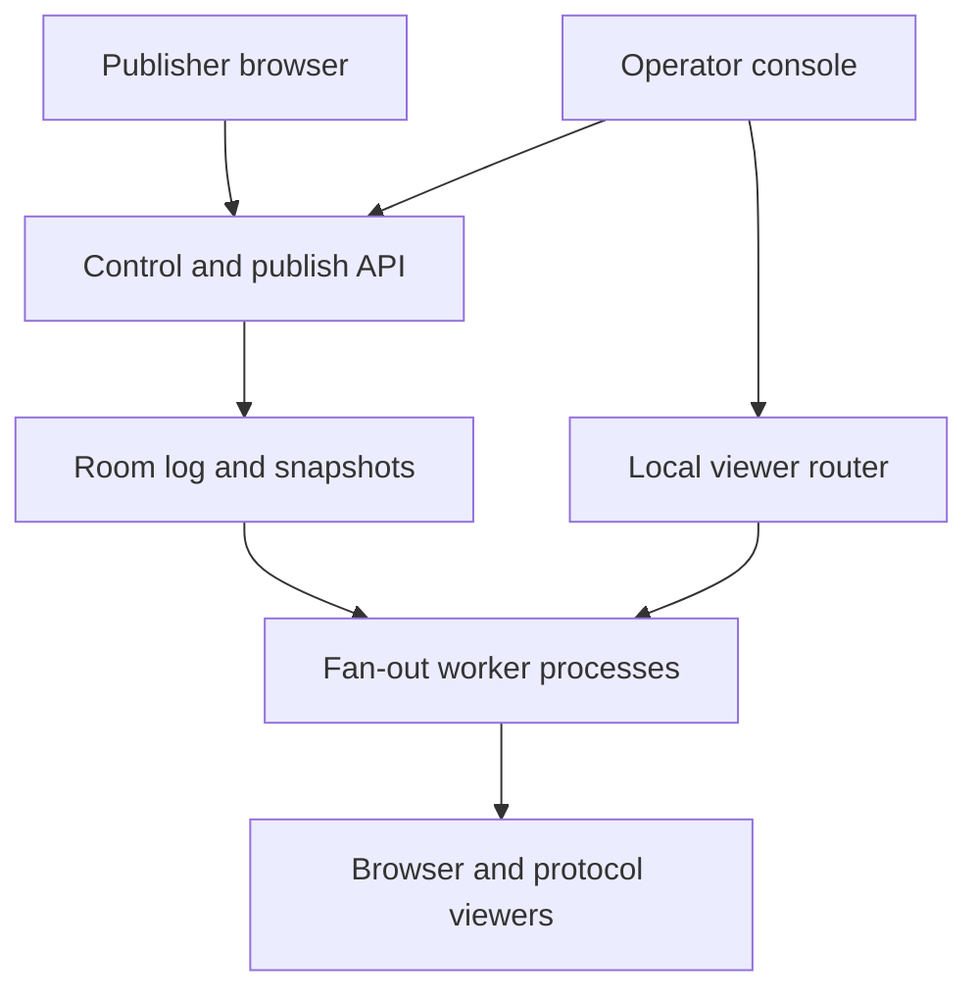

# CrowdLattice Requirements

Version 0.3 | 23 November 2026 | Backend language agnostic | Basic browser UI required

**Project name:** CrowdLattice  
**Product scope:** Mass audience live event platform  
**Suggested repository slug:** `crowdlattice`

## 1 Purpose and product

Build CrowdLattice, a browser application for a large live event: viewers join a room, receive ordered scoreboard/status updates and announcements, reconnect after interruption, and see explicit recovery or overload states. Operators publish updates, inspect audience distribution, drain a fan-out worker and investigate delivery lag.

The architecture explores a target of 5 million concurrent viewers. The required implementation is an actual local application with separate fan-out processes, real streaming connections, durable room history and controlled load tests. Five million concurrent viewers is an unvalidated deployment hypothesis, not a desktop acceptance claim.

This product distributes live application updates, not video or audio. Video capture, encoding, playback quality, adaptive bitrate delivery and CDN operation are outside the submitted goal. No claim that this project can stream video to 5 million people may be made from its results.

## 2 Why the project is substantial

The difficult work is one hot room being consumed by many sessions without a database query per viewer per event, preserving event order through reconnects, bounding slow-client memory, and recovering a failed fan-out worker without a reconnect storm. The product needs coordinated state, browser behaviour, streaming I/O, recovery and credible measurement together.

Users are fictional event viewers, event publishers, operators and developers investigating capacity. The demonstration uses generated teams/devices, scores, announcements and viewer identities. It uses no employer infrastructure, real viewers, personal data, customer accounts or commercial video assets.

## 3 Scale and evidence contract

| Level | Requirement and permitted claim |
| --- | --- |
| Product core | Local room creation, publication, real browser delivery, replay, reconnect and worker recovery must run end to end. |
| Local qualification | Begin with 100 real streaming client connections; provisional target is 500 across 3 fan-out processes on the supplied machine. |
| Larger local experiments | Increase real clients only within measured CPU, memory, socket and load-generator limits. Preserve failed runs. |
| Capacity analysis | Model 5 million concurrent sessions using recorded assumptions and measurements, with uncertainty and headroom. |
| Logical simulation | Optional millions-of-session placement calculations use simulated records; they are never counted as live sockets. |
| Production proof | Requires separate authorized infrastructure and tests; not part of this restricted-desktop project or its success bar. |

Do not substitute 5 million page views, stored rows, sequential requests or simulated clients for simultaneous real connections. The local success criteria stand independently even if the large-scale hypothesis is not yet achievable.

All programme eligibility, independent project origin, code ownership and approval requirements remain external decisions. This AI-assisted requirements reference is not a participant-authored submission or an approval certificate.

## 4 Fit with the restricted desktop

Run an API/control process, a durable local store and at least 3 fan-out worker processes over loopback. Serve the browser UI and all assets locally. The load generator uses actual local network sockets and generated data. No internet, Docker, GPU, sound, native desktop toolkit, cloud account or Windows component is needed.

Choose language/framework and one permitted local storage technology after a mirror/dependency inventory. Standard browser event streaming or an equivalent supported protocol is sufficient. No external broker, CDN or managed service is a hidden prerequisite. If resource limits prevent the provisional 500-client target, report the actual maximum and obtain an explicit target revision; do not relabel a smaller test as 5-million capacity.

## 5 Release scope and exclusions

Required: versioned event rooms; immutable ordered publications; idempotent publisher requests; materialized room snapshots; bounded replay; fan-out sharding; session ownership generations; reconnect tokens; per-client backpressure; worker drain/recovery; approximate presence; admission capacity; operator and viewer UIs; local load/fault harness; measurements and capacity workbook.

Deferred: video/audio, free-form public chat, actual millions of connections, multi-region consensus, global identity, billing, public deployment, cross-machine failover, mobile apps, AI functionality, untrusted user code and production moderation. Core correctness uses one authoritative local durable store; a shared store outage is not masked as a production-available cluster.

## 6 Reference scenario

Create a fictional championship room and a second independent room. A publisher emits deterministic score/status events at 10 events/second for the local fan-out exercise. Open viewer browsers and 500 headless protocol clients distributed across 3 workers. Pause one client, kill one worker, restart the publisher and force selected clients to reconnect with earlier cursors.

Every client records room generation, last applied sequence, detected duplicates/gaps and delivery lag. After recovery, healthy clients must reach the same snapshot digest through a shared final sequence. Slow clients must receive an explicit reset/disconnect rather than make memory grow indefinitely.

## 7 Definitions and guarantees

Room ID and generation identify one event history. Sequence starts at 1, increases on committed publications and never resets within a generation. A snapshot is room state through a specific sequence S. A viewer cursor is the last sequence applied, not merely sent over a socket.

The service guarantees committed publication durability under its store settings, per-room ordered data and explicit recovery from detectable gaps. Streaming delivery may repeat around reconnect; clients discard already applied sequences. There is no universal exactly-once network delivery guarantee.

A successful publish proves durable acceptance, not that all connected browsers received it. Operator presence is a timestamped estimate; allocated capacity, active sockets and unique currently owned viewer sessions are different metrics and must not be conflated.

## 8 Room and publication requirements

| ID | Requirement |
| --- | --- |
| ROOM-01 | Create a room with immutable ID/generation, bounded event schema and versioned configuration. |
| ROOM-02 | Room states are DRAFT, LIVE and ENDED. Start/end use expected revision and operation key; ENDED does not reopen. |
| ROOM-03 | Publishing accepts only registered event types: score-set, status-set and announcement. Payloads are plain validated data. |
| ROOM-04 | Canonical event, next sequence, room snapshot/reducer state and publisher receipt commit atomically. Rollback exposes no sequence gap. |
| ROOM-05 | Same publisher key and request returns the original event; changed content with that key conflicts. |
| ROOM-06 | Publication is bounded to 8 KiB/event, with a 256-byte synthetic payload profile for capacity analysis. |
| ROOM-07 | Ending a room rejects new events and emits an ordered terminal event. Retained reads and snapshot inspection remain possible. |

Use a documented canonical serialization and content digest; reject duplicate JSON keys, invalid numbers, unknown fields and unsupported versions. Snapshot reduction must be deterministic and validated against an independent reference reducer. Browser labels and announcements are escaped text, never arbitrary HTML.

## 9 Snapshot and replay protocol

A new viewer receives a snapshot through sequence S and then events after S. Snapshot state and S come from one consistent durable view. The subsequent subscription must catch up from S before following live updates so an event between snapshot read and connection establishment is not lost.

Reconnect supplies room generation, session identity/generation and last applied sequence. Within the replay window, return events in order before live tailing. A cursor from another room/generation, a cursor beyond high-water, or malformed cursor is rejected.

Keep a bounded replay window, initially 10,000 events or 10 minutes, with an explicit low-water. If history is no longer retained, send RESET_REQUIRED and a new snapshot; never silently skip to the newest event. Snapshots and retained events must overlap consistently at the retention boundary. A reset is visible in the viewer UI and metrics.

## 10 Fan-out and hot-room design

Each worker maintains at most one upstream room feed for its subscribed viewers, sharing immutable encoded event buffers where practical. It must not fetch or deserialize the same room event independently for every viewer. The number of authoritative room-feed reads scales primarily with subscribed workers/rooms, not viewer count.

The same hot room must be distributable across all 3 local workers. Placement by room alone cannot assign a 5-million-viewer room to one process. Use stable virtual buckets based on room/session IDs plus a versioned worker map; the exact routing algorithm is an implementation decision with tests.

Worker capacity, outbound bytes and per-room subscriptions are observable. Routing should avoid full workers and retain bounded spare capacity. Worker changes must preserve event identity and cursors. No worker-local memory is the sole durable publication history.

## 11 Session ownership and admission

| ID | Requirement |
| --- | --- |
| SES-01 | Synthetic viewer sessions have opaque IDs and replaceable connection generations. A new connection generation supersedes the prior one. |
| SES-02 | Join/reconnect is idempotent by scoped request key and cannot create unbounded duplicate session records. |
| SES-03 | Allocate finite worker capacity grants atomically; total active grants never exceed the configured local global cap. |
| SES-04 | Unused granted capacity remains reserved until release/expiry, preventing over-admission through optimistic counters. |
| SES-05 | A worker losing its capacity/ownership lease stops admission and streaming before using expired authority. |
| SES-06 | Control-store uncertainty produces bounded degraded behaviour: existing streams run only under still-valid grants; no new grants are invented. |
| SES-07 | Session transport values are disposable local demo credentials, never real account tokens. |

Proposed worker-grant TTL is 15 seconds, renewal every 5 seconds. Document durable-time versus process-monotonic-clock conversion and a conservative expiry margin. A process resumed after a long scheduling pause checks expiry before sending again. Session migration excludes old generations from unique presence, although duplicate event delivery during reconnection remains possible and harmless after cursor deduplication.

Admission over the configured cap returns a retryable overload response with jitter guidance. It does not accept a socket and wait indefinitely in an unbounded queue. No production bot resistance or proof that one synthetic ID equals one real human is claimed.

## 12 Backpressure and reconnection control

Per-client buffered outbound data is bounded, proposed 64 KiB and/or 256 frames. When a reliable event would overflow the limit, close that client's stream with a recoverable slow-consumer reason and retain its last known cursor semantics. Do not silently drop scoreboard events. Presence summaries may be coalesced because they are explicitly nonauthoritative observations.

Bound replay work, concurrent snapshot generation and joins per worker. Cache/share identical snapshots by room generation/sequence; collapse concurrent snapshot rebuilds. Reconnect uses bounded exponential backoff and jitter. A server-provided delay is a minimum, not a synchronized wake-up instruction for all clients.

Heartbeats distinguish a healthy idle room from a broken transport; they do not advance the application sequence. Disconnecting a viewer frees local resources once and updates observed counts. Work that belongs to a stalled client cannot delay unrelated clients or the operator health endpoint.

## 13 Worker drain failure and recovery

Worker lifecycle: STARTING, READY, DRAINING, UNAVAILABLE, STOPPED. Draining stops new joins, signals reconnect hints with staggered delays and allows bounded active delivery before shutdown. Failed-worker grants expire; replacement workers use new process identities and subscription positions.

Routing-map revisions and worker generations are checked on join and migration. A stale worker cannot reclaim ownership by advertising its old ID. Several local reconcilers may observe the same expiry; conditional transitions and unique grants prevent double reassignment.

Publisher restart reuses durable keys or creates explicit new events; it must not repeat the same fixture sequence as new content accidentally. Store outage stops publishing and new admission, preserves current cursors, and returns clear readiness failure. Restart must not erase event history, reset room generation or fabricate live audience counts.

## 14 Presence and observability semantics

Workers report aggregated active-socket and current-session estimates periodically, initially every 5 seconds. Presence is best effort with an age indicator, not a database write for every viewer on every event. Exclude expired worker generations from the estimate. Do not use approximate presence to decide strict admission caps.

Metrics include active connections, allocated capacity, admission rejects, events published/delivered, per-room fan-out factor, egress bytes, send lag, slow consumers, replay/reset counts, reconnect arrival rate and worker health. Label actual socket counts separately from simulated logical population. Histograms include disconnects/timeouts and generator failures, not just fast successful viewers.

## 15 Logical records and transaction boundaries

Required entities: Room; immutable RoomEvent; consistent RoomSnapshot; PublishReceipt; WorkerInstance; CapacityGrant; versioned RoutingMap; ViewerSessionOwnership; bounded ReplayCursor metadata; OperatorAudit; SchemaMigration. Enforce nonnull identities, unique room/generation/sequence, unique scoped keys, positive grants and immutable terminal state.

Publish/snapshot/receipt and admission/grant mutations each have documented atomic boundaries. Network sends are not part of the database commit. Event delivery uses the committed log; cached snapshots can be discarded and rebuilt. Route configuration uses expected revision and complete activation, never a partially installed worker map.

Record session/grant history at joins/ownership changes rather than every frame. Initial retained-data cap and cleanup must preserve publisher receipts needed for uncertain requests. Consistent backup includes room generation, events, snapshot baseline and receipts together.

## 16 API and streaming contract

| Endpoint | Behaviour |
| --- | --- |
| GET /api/health, /api/ready | Separate liveness and durable-store/schema readiness. |
| POST /api/rooms | Create bounded room definition. |
| POST /api/rooms/{id}/start, /end | Revision-checked lifecycle transitions. |
| POST /api/rooms/{id}/events | Keyed validated publisher event. |
| GET /api/rooms/{id}/snapshot | State plus generation, sequence and digest in one snapshot. |
| POST /api/rooms/{id}/join | Allocate/reconcile session ownership and return local worker target. |
| GET /stream/rooms/{id} | Streaming frames with sequence and resume cursor. |
| GET /api/rooms/{id}/events | Bounded replay inspection. |
| POST /api/workers/{id}/drain | Operator-controlled bounded worker drain. |
| GET /api/audience, /api/workers, /api/metrics | Actual/estimated counts, ages and pressure. |

Frame example: `{"roomGeneration":"demo-1","sequence":42,"type":"score-set","payload":{"home":2,"away":1}}`. SSE is a suitable transport; an equivalent documented browser protocol is allowed. Do not expose reusable tokens in URLs or logs. Define heartbeat/reset/end/error frames separately from application events.

Malformed requests return 400, invalid content 422, stale generation/revision/key 409, oversized bodies 413, admission pressure 429 or 503 with documented meaning, and unavailable storage 503. Limit read pages to 200 and ordinary JSON responses to 1 MiB. Streaming limits are per frame/buffer rather than an unbounded whole-response allocation.

## 17 Browser experience

Viewer screens show event selection, snapshot loading, connected/reconnecting/reset states, current score/status, ordered announcements and last update age. Operator screens show room lifecycle, publish form, real connections per worker, allocation versus presence, slow clients, replay lag and drain controls.

Two tabs exercise independent sessions unless explicitly sharing a synthetic session ID for ownership tests. Refresh resumes from the documented cursor or fetches a consistent reset. Provide keyboard access, text states, accessible tables for charts and no success notification before durable publish acceptance. No screen may display a modeled 5-million population as actual connected viewers.

### Basic HTML and JavaScript or TypeScript UI

A basic working UI is a mandatory release deliverable. Use semantic HTML, ordinary CSS and plain JavaScript, or TypeScript compiled to browser JavaScript. The backend implementation language remains open. Use native browser APIs for HTTP requests and the selected streaming protocol. Tables, forms, status labels and optional small SVG charts are sufficient.

| Minimum view | Visible information and working controls |
| --- | --- |
| Viewer page | Room selector, join/reconnect control, current score/status, announcements, connection state, last sequence and update age. |
| Operator page | Room creation/start/end, validated event publish form, worker table, active sockets, allocated capacity and drain action. |
| Diagnostics panel | Readiness, reconnect/reset counts, slow-client count and bounded recent events/errors. |

| ID | Basic UI requirement |
| --- | --- |
| LA-UI-01 | Serve HTML, CSS, scripts and optional assets from the local application origin; all required flows work without external connectivity. |
| LA-UI-02 | JavaScript is the dependency-minimal path. If TypeScript is selected, use a compiler available through the permitted mirror, document the local compile command and serve the generated JavaScript. Browsers must not require a TypeScript compiler or internet downloads at runtime. |
| LA-UI-03 | Keep the frontend small: an HTML entry page, CSS file and JavaScript modules, with corresponding TypeScript source only if chosen. Any selected library must be bundled locally and pass the dependency gate; no framework is required. |
| LA-UI-04 | Wire controls to real local APIs and the real streaming connection. Show loading, accepted, reconnecting, stale, empty and error states from actual server outcomes. |
| LA-UI-05 | Bound the rendered event list, reuse the active stream and release browser resources when switching rooms. A UI refresh must not create uncontrolled duplicate connections. |
| LA-UI-06 | Labels, keyboard operation, text status and inline validation cover every action. Operator actions remain authorized and validated by the backend. |

Frontend acceptance is functional: a reviewer can join a room, publish an update, see it arrive, interrupt a worker, observe recovery and inspect the resulting state using the basic pages. Bulk load remains the separate protocol-client harness; the UI does not create millions of DOM elements or claim that a displayed population is measured live traffic.

## 18 Local qualification and load methodology

Local target: 500 real protocol connections across 3 workers, one hot room at 10 events/second with 256-byte payload, plus a separate small room. Provisional healthy delivery p95 <=500 ms and p99 <=2 seconds; UI observation within 3 seconds; recovery after worker loss <=20 seconds plus documented client backoff. Measure end-to-end application timestamps only with known same-host clocks.

Start at 100 connections, then 250 and 500. Record attempted/established/active/disconnected sockets, generator CPU/RAM, server CPU/RAM, open file descriptors, byte rate and per-client event counts. Preserve the offered load schedule and actual start lag. Open-loop join storms and steady streaming are separate tests. Browser tests use a small number of real tabs; bulk protocol clients are not mislabeled as rendered browsers.

Bound server/store memory to a provisional 2 GiB, generator separately to 1 GiB, with a stop threshold below workspace exhaustion. No system-wide tuning, privileged changes, production targets or outside traffic is required. If the generator saturates first, the run is generator-limited, not proof of a server ceiling.

## 19 Five-million-viewer capacity study

For an illustrative 256-byte update once per second per viewer, 5,000,000 × 256 = 1,280,000,000 application bytes/second, or 10.24 Gbit/second, before framing, TLS, transport overhead and retransmission. This is arithmetic under an assumption, not a network benchmark. Ten updates/second multiplies that base traffic by ten.

At an illustrative 16 KiB of retained state per connection, 5 million connections consume 81.92 GB (decimal) for that state alone, excluding runtime, buffers, operating system and spare capacity. Reconnecting 20 percent of the audience over 30 seconds means about 33,333 join attempts/second. These dimensions must be modeled separately.

The required capacity report uses measured sustainable sockets, egress and CPU per local worker, applies explicit safety headroom and a worker-failure reserve, and calculates the maximum of memory-, CPU-, socket- and bandwidth-driven node counts. Do not sum incompatible limits or linearly extrapolate a saturated single-node result. Document shared-store, publisher hot-room, routing, inter-worker fan-out, TLS and regional failure bottlenecks left untested.

A proposed production topology may use regional routing and edge fan-out, but no real CDN, cloud deployment or paid infrastructure is necessary to complete the local project. Multi-region fault tolerance and true 5-million capacity remain unverified.

## 20 Acceptance catalog

| ID | Required scenario and pass oracle |
| --- | --- |
| LA-AC-01 | Publish lifecycle rejects invalid transitions/schema and preserves immutable room generation. |
| LA-AC-02 | Same-key publish and lost-response replay create one ordered event; changed content conflicts. |
| LA-AC-03 | Concurrent publishers produce unique contiguous committed sequences and correct snapshot digest. |
| LA-AC-04 | Snapshot/subscription race loses no event between S and live tail. |
| LA-AC-05 | Reconnect within retained range replays in order; duplicate frames never regress client state. |
| LA-AC-06 | Cursor below low-water produces an explicit reset with consistent snapshot, not silent loss. |
| LA-AC-07 | One hot room spreads over 3 workers and uses bounded upstream feeds independent of viewer count. |
| LA-AC-08 | Concurrent joins respect aggregate grant capacity and return explicit overload at the cap. |
| LA-AC-09 | Superseded session generations are excluded from unique presence and cannot reclaim ownership. |
| LA-AC-10 | Slow client reaches its buffer bound and resets/disconnects without harming healthy clients. |
| LA-AC-11 | Worker hard kill causes grant expiry and resumable reconnect; no sequence reset or fabricated receipt. |
| LA-AC-12 | Drain stops new joins and staggers reconnects within recorded bounds. |
| LA-AC-13 | Store outage stops new publish/admission; expired worker grants do not continue unauthorized streams. |
| LA-AC-14 | Reconnect storm is bounded by admission/backoff rather than unbounded pending sockets. |
| LA-AC-15 | Room end is ordered, rejects later publication and remains inspectable. |
| LA-AC-16 | Presence has age/generation semantics and is not used as exact admission authority. |
| LA-AC-17 | 500-real-connection target records payload, actual sockets, lag, byte rate and generator limitations. |
| LA-AC-18 | Two-room test proves a slow/hot room does not permanently starve the other room. |
| LA-AC-19 | Viewer/operator browser journeys, reload, keyboard access and stale tabs behave correctly. |
| LA-AC-20 | Origin/role/size/input checks and disabled-by-default fault controls pass. |
| LA-AC-21 | Consistent restore preserves generation, sequence, snapshot and publisher receipts. |
| LA-AC-22 | Thirty-minute bounded soak has stable resources and no unexplained event gap in healthy clients. |
| LA-AC-23 | Entire core journey runs offline with only loopback services. |
| LA-AC-24 | Capacity report distinguishes measurement, simulation and 5-million arithmetic; no unsupported production claim. |
| LA-AC-25 | Basic HTML/CSS/JS or compiled-TS pages load entirely locally and complete join, publish, reconnect, drain and diagnostics flows with keyboard access and actual backend state; any selected TypeScript build works through the permitted local toolchain. |

All cases start NOT RUN. Keep commit/environment, fixtures, expected hashes, receipts, socket counts, barrier logs and failed rounds. Repeat critical crash windows 20 times and ownership/admission races 100 rounds. Required invariants include immutable publication, no cursor regression, bounded buffers, valid grants and explicit gap/reset handling.

## 21 Milestones and deliverables

| Milestone | Checkable result |
| --- | --- |
| 1 | Verify permitted tools and local resource baseline; browser/control API/store ready. |
| 2 | Room lifecycle, ordered publish, receipts and independent snapshot reducer pass tests. |
| 3 | One real streaming worker and browser support consistent join/resume/reset. |
| 4 | Three-worker hot-room placement, ownership and capacity grants pass contention. |
| 5 | Backpressure, drain and failure/reconnect tests pass with bounded memory. |
| 6 | Operator visibility, browser journeys and local access controls are complete. |
| 7 | Run staged real-socket load, crash repetitions and soak; preserve limits and failed runs. |
| 8 | Deliver capacity study, offline setup, backup/restore and complete evidence report. |

Each milestone can span multiple sessions. Deliver source/licence notices, protocol/schema contracts, local launch scripts, synthetic publisher and real-connection generator, browser UI, fault harness, acceptance report, measurements, capacity calculator and continuation notes. Do not overwrite actual evidence when regenerating templates.

## 22 Open decisions and references

Choose language/framework, one local durable store, supported streaming transport, canonical serialization, routing algorithm and calibrated resource bounds before implementation. None is fixed by this document.

Primary conceptual references:

- Browser server-sent events and event IDs: https://developer.mozilla.org/en-US/docs/Web/API/Server-sent_events/Using_server-sent_events
- AWS timeout/backoff/jitter principles: https://aws.amazon.com/builders-library/timeouts-retries-and-backoff-with-jitter/
- Discord account of large-scale message storage and hot spots: https://discord.com/blog/how-discord-stores-trillions-of-messages

These references motivate engineering choices. They do not provide a capacity guarantee for this project or authorize use of those services during evaluation.
